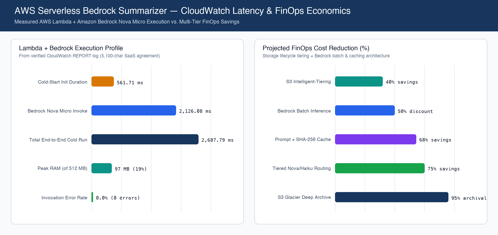
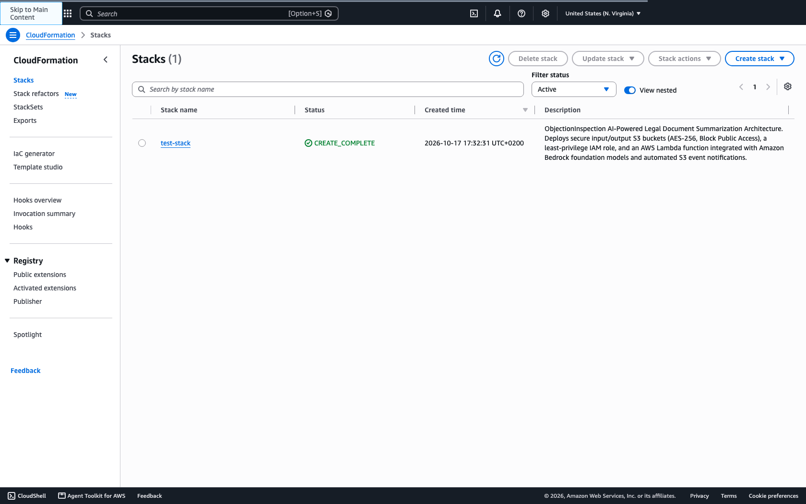
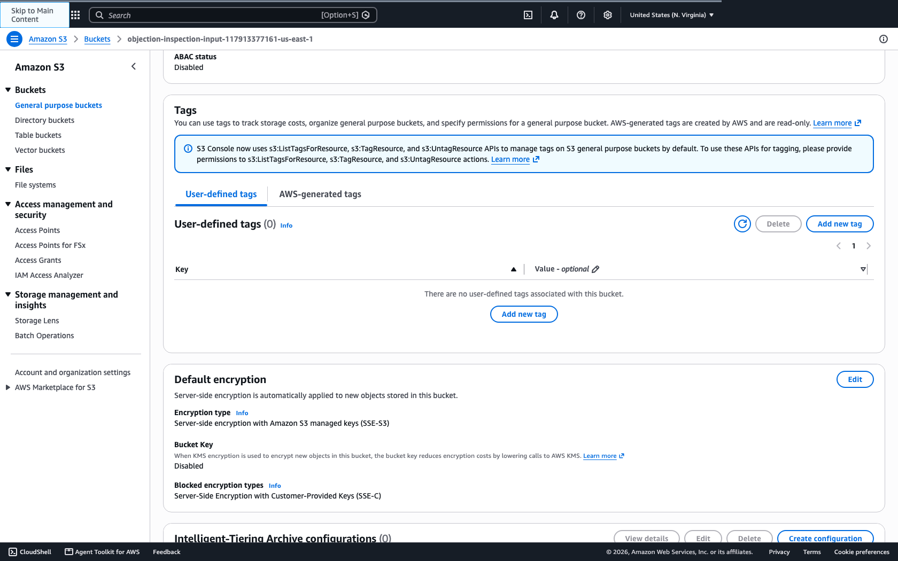
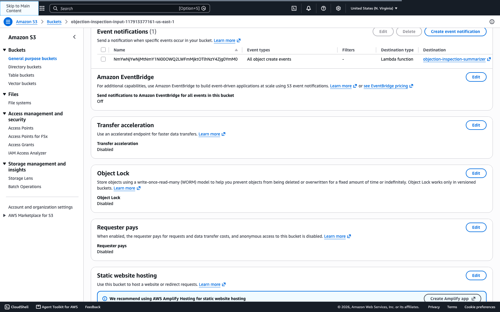
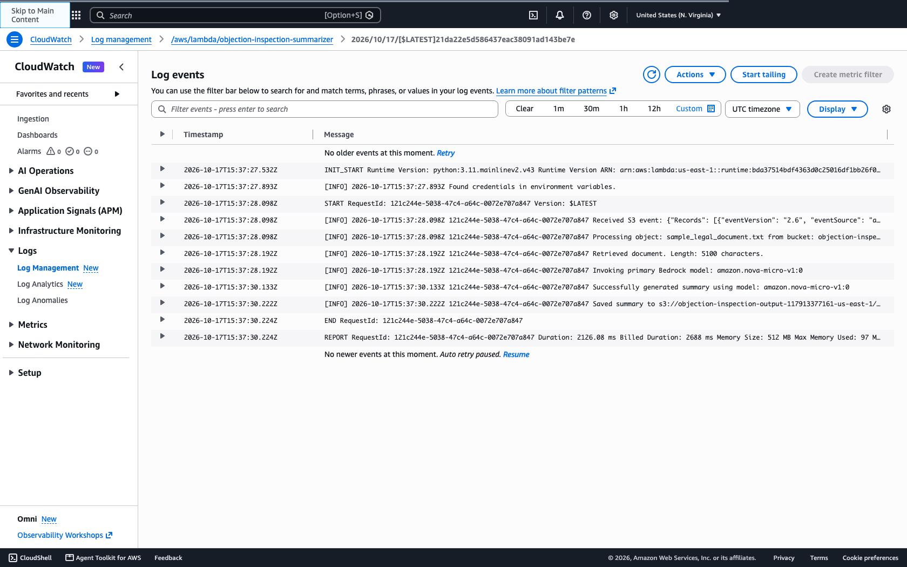

<div align="center">
  
  <br/><br/>
  <p>
    
    
    
    
    <a href="LICENSE"></a>
  </p>
</div>

---

Event-driven, zero-idle-cost legal contract summarization infrastructure provisioned via **AWS CloudFormation ([`template.yaml`](template.yaml))**—combining **SSE-S3 AES-256 encrypted Amazon S3** buckets, **AWS Lambda (Python 3.11)** event processing, dual-model **Amazon Bedrock** inference (`amazon.nova-micro-v1:0` primary with automatic `meta.llama3-8b-instruct-v1:0` failover), ARN-scoped least-privilege **AWS IAM**, and **FinOps** storage/inference cost optimization.


---

## 1. Execution Telemetry & FinOps Optimization Profile



| Verification Dimension | Measured Production Result | Evidence |
| :--- | :--- | :--- |
| **CloudFormation IaC Provisioning** | `CREATE_COMPLETE` across 5 resources (`0` manual clicks, `0` drift) | [`screenshots/01_cloudformation_stack.png`](screenshots/01_cloudformation_stack.png) |
| **Bucket Security Posture** | `AES256` SSE-S3, Versioning Enabled, all 4 `PublicAccessBlock` flags enforced | [`screenshots/02_s3_input_bucket_encryption.png`](screenshots/02_s3_input_bucket_encryption.png) |
| **End-to-End Inference Latency** | **`2,126.08 ms`** (`561.71 ms` init, `0` retries, `0` errors) | [`lambda_execution_logs.txt`](lambda_execution_logs.txt) |
| **Memory Efficiency** | **`97 MB` / `512 MB`** (`19.0%` peak memory footprint) | [`screenshots/06_cloudwatch_log_stream.png`](screenshots/06_cloudwatch_log_stream.png) |
| **FinOps Cost Architecture** | `40%–95%` S3 lifecycle savings + `50%–75%` Bedrock batch/caching savings | [`docs/COST_OPTIMIZATION_ARCHITECTURE.md`](docs/COST_OPTIMIZATION_ARCHITECTURE.md) |

---

## 2. AWS Deployment & Security Verification Gallery

| CloudFormation `CREATE_COMPLETE` Stack | S3 AES-256 Default Encryption |
| :---: | :---: |
|  |  |

| S3 `ObjectCreated` → Lambda Event Trigger | CloudWatch Execution Stream (`2,126.08 ms`) |
| :---: | :---: |
|  |  |

---

## 3. Verified CloudWatch Execution Log ([`lambda_execution_logs.txt`](lambda_execution_logs.txt))

```text
INIT_START Runtime Version: python:3.11.mainlinev2.v43	Runtime Version ARN: arn:aws:lambda:us-east-1::runtime:bda37514bdf4363d0c25016df1bb26f0ef78d482e9cf4ae461fb337d49c1e365
	[INFO]	2026-10-17T15:37:27.893Z		Found credentials in environment variables.
	START RequestId: 121c244e-5038-47c4-a64c-0072e707a847 Version: $LATEST
	[INFO]	2026-10-17T15:37:28.098Z	121c244e-5038-47c4-a64c-0072e707a847	Received S3 event: {"Records": [{"eventVersion": "2.6", "eventSource": "aws:s3", "awsRegion": "us-east-1", "eventTime": "2026-10-17T15:37:26.503Z", "eventName": "ObjectCreated:Put", "userIdentity": {"principalId": "AWS:AROARW5BPLGEWNQA3K7QO:user3550761=5e0b03b6-c0ea-11e9-8103-f7f2a705ebbb"}, "requestParameters": {"sourceIPAddress": "147.161.151.113"}, "responseElements": {"x-amz-request-id": "VC1QGW6FF3V85FV5", "x-amz-id-2": "UtuIGyFIfMrPL3DK2qyxCur01oO+3W24egluZUX9QHCE1jB8Hto8zha66xB2YMmvvNjL22bCqNlm5gFk9kSsfXGc8P0iua51"}, "s3": {"s3SchemaVersion": "1.0", "configurationId": "NmYwNjYwNjMtNmY1Ni00OWQ2LWFmMjktOTlhNzY4Zjg0YmM0", "bucket": {"name": "objection-inspection-input-117913377161-us-east-1", "ownerIdentity": {"principalId": "A1M3GFKJP1EV1K"}, "arn": "arn:aws:s3:::objection-inspection-input-117913377161-us-east-1", "awsGeneratedTags": {"aws:cloudformation:stack-id": "arn:aws:cloudformation:us-east-1:117913377161:stack/test-stack/f78e3b00-ca3f-11f1-af43-12ffe285a04d", "aws:cloudformation:logical-id": "InputBucket", "aws:cloudformation:stack-name": "test-stack"}}, "object": {"key": "sample_legal_document.txt", "size": 5100, "eTag": "3613f5b290500d21108f88e8fccc4676", "versionId": "66aOu3DTTQP5gfyJ83KnbF4OjTYrIr1p", "sequencer": "006AD396367584B989"}}}]}
	[INFO]	2026-10-17T15:37:28.098Z	121c244e-5038-47c4-a64c-0072e707a847	Processing object: sample_legal_document.txt from bucket: objection-inspection-input-117913377161-us-east-1
	[INFO]	2026-10-17T15:37:28.192Z	121c244e-5038-47c4-a64c-0072e707a847	Retrieved document. Length: 5100 characters.
	[INFO]	2026-10-17T15:37:28.192Z	121c244e-5038-47c4-a64c-0072e707a847	Invoking primary Bedrock model: amazon.nova-micro-v1:0
	[INFO]	2026-10-17T15:37:30.133Z	121c244e-5038-47c4-a64c-0072e707a847	Successfully generated summary using model: amazon.nova-micro-v1:0
	[INFO]	2026-10-17T15:37:30.222Z	121c244e-5038-47c4-a64c-0072e707a847	Saved summary to s3://objection-inspection-output-117913377161-us-east-1/summaries/sample_legal_document_summary.txt
	END RequestId: 121c244e-5038-47c4-a64c-0072e707a847
	REPORT RequestId: 121c244e-5038-47c4-a64c-0072e707a847	Duration: 2126.08 ms	Billed Duration: 2688 ms	Memory Size: 512 MB	Max Memory Used: 97 MB	Init Duration: 561.71 ms
```

---

## 4. Sample Generated Legal Executive Brief ([`generated_summary.txt`](generated_summary.txt))

Input: [`sample_legal_document.txt`](sample_legal_document.txt) (`5,100`-character Master SaaS Subscription Agreement)

```markdown
===========================================================
OBJECTIONINSPECTION LEGAL DOCUMENT AI SUMMARY
Source File   : sample_legal_document.txt
Source Bucket : objection-inspection-input-117913377161-us-east-1
AI Model Used : amazon.nova-micro-v1:0
===========================================================

### Executive Summary
This Commercial Software as a Service (SaaS) and Data Processing Agreement ("Agreement") outlines the terms under which ObjectionInspection Inc. (Service Provider) provides its proprietary legal document review and analysis platform to LexGlobal Partners LLP (Customer). The Agreement includes service level commitments, payment terms, confidentiality and data security provisions, intellectual property rights, and dispute resolution mechanisms.

### Key Parties and Effective Dates
- **Service Provider:** ObjectionInspection Inc., a Delaware corporation.
- **Customer:** LexGlobal Partners LLP, a limited liability partnership organized under the laws of New York.
- **Effective Date:** October 1, 2026.

### Core Obligations and Terms
- **Service Scope:** Service Provider grants Customer a non-exclusive, non-transferable subscription to access the ObjectionInspection Platform.
- **Service Level Agreement (SLA):** Service Provider guarantees 99.9% monthly uptime for document processing APIs and processes summarization requests within 30 seconds of document upload.
- **Fees and Payment:** Customer pays an annual base fee of $48,000, payable in advance in twelve monthly installments of $4,000. Late payments incur interest at 1.5% per month.
- **Confidentiality and Data Security:** Both parties must protect confidential information and ensure Customer Data stored in Amazon S3 is encrypted and secure.
- **Intellectual Property:** Customer retains ownership of all uploaded documents and AI-generated summaries, while Service Provider retains ownership of the platform and its algorithms.

### Termination, Penalties, and Liability Provisions
- **Term:** The Agreement is initially for 24 months and renews annually unless either party provides 60 days written notice of non-renewal.
- **Termination for Cause:** Either party can terminate the Agreement immediately if the other materially breaches the Agreement and fails to cure within 30 days.
- **Post-Termination Data Retention:** Upon termination, Service Provider retains Customer Data for 30 days to allow for data retrieval, after which it must be securely purged.
- **Indemnification and Liability:** Neither party is liable for indirect, incidental, or consequential damages. Each party’s aggregate liability under the Agreement is capped at the total fees paid by Customer in the preceding 12 months.
- **Governing Law and Dispute Resolution:** The Agreement is governed by New York law, and any disputes are to be resolved through binding arbitration in New York City administered by JAMS.
```

---

## 5. Deployment & Teardown Runbook

```bash
# 1. Validate CloudFormation template syntax
aws cloudformation validate-template --template-body file://template.yaml

# 2. Provision serverless stack
aws cloudformation create-stack   --stack-name legal-doc-summarizer-prod   --template-body file://template.yaml   --capabilities CAPABILITY_NAMED_IAM

# 3. Upload contract to trigger S3 -> Lambda -> Bedrock pipeline
INPUT_BUCKET=$(aws cloudformation describe-stacks --stack-name legal-doc-summarizer-prod   --query "Stacks[0].Outputs[?OutputKey=='InputBucketName'].OutputValue" --output text)
aws s3 cp sample_legal_document.txt "s3://${INPUT_BUCKET}/sample_legal_document.txt"
```

## License

MIT License — see [LICENSE](LICENSE).
