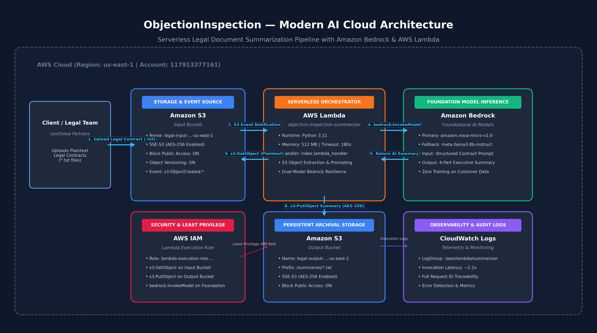

# Serverless Legal Document AI Summarization Pipeline on AWS

Event-driven, zero-idle-cost legal contract summarization infrastructure provisioned via **AWS CloudFormation (`template.yaml`)**—integrating AES-256 encrypted **Amazon S3** buckets, **AWS Lambda** (Python 3.11), dual-model **Amazon Bedrock** inference (`amazon.nova-micro-v1:0` with automatic `meta.llama3-8b-instruct-v1:0` fallback), strict ARN-scoped least-privilege **AWS IAM**, and **Amazon CloudWatch** telemetry.



---

## Verified Cloud Deployment & Performance Metrics

| Metric / Verification Check | Result | Artifact Reference |
| :--- | :--- | :--- |
| **CloudFormation Stack Provisioning** | `CREATE_COMPLETE` (5 managed resources, 0 drift) | [`template.yaml`](template.yaml), [`screenshots/01_cloudformation_stack.png`](screenshots/01_cloudformation_stack.png) |
| **S3 Security Posture** | SSE-S3 (`AES256`), Versioning Enabled, `PublicAccessBlock` (all 4 flags) | [`screenshots/02_s3_input_bucket_encryption.png`](screenshots/02_s3_input_bucket_encryption.png) |
| **End-to-End Bedrock Inference Latency** | **`2,126.08 ms`** (`561.71 ms` cold-start init, `0` errors) | [`lambda_execution_logs.txt`](lambda_execution_logs.txt) |
| **Lambda Peak Memory Footprint** | **`97 MB` / `512 MB`** (`19%` utilization) | [`screenshots/06_cloudwatch_log_stream.png`](screenshots/06_cloudwatch_log_stream.png) |
| **Legal Contract Summarization** | `5,100`-char SaaS agreement → structured 4-part executive legal brief | [`sample_legal_document.txt`](sample_legal_document.txt) → [`generated_summary.txt`](generated_summary.txt) |
| **FinOps Optimization Roadmap** | `40%–95%` storage savings + `60%–75%` Bedrock batch/caching savings | [`docs/COST_OPTIMIZATION_ARCHITECTURE.md`](docs/COST_OPTIMIZATION_ARCHITECTURE.md) |

---

## Repository Structure

```text
aws-bedrock-legal-summarizer-iac/
├── template.yaml                         # Complete CloudFormation IaC template (S3, IAM, Lambda, Bedrock)
├── architecture_diagram.png              # Event-driven AWS architecture diagram
├── sample_legal_document.txt             # Input SaaS Master Subscription Agreement
├── generated_summary.txt                 # Live Bedrock Nova Micro structured legal summary
├── lambda_execution_logs.txt             # Raw CloudWatch START/REPORT invocation logs
├── docs/
│   ├── VALIDATION_REPORT.md              # Step-by-step stack & security verification evidence
│   ├── COST_OPTIMIZATION_ARCHITECTURE.md # S3 Intelligent-Tiering, Glacier & Bedrock FinOps design
│   └── CLEANUP_CONFIRMATION.md           # Stack teardown & zero-orphan audit
└── screenshots/                          # 9 AWS Console deployment & CloudWatch verification captures
```

---

## Deployment

```bash
# Validate CloudFormation template
aws cloudformation validate-template --template-body file://template.yaml

# Deploy serverless stack
aws cloudformation create-stack   --stack-name legal-doc-summarizer-prod   --template-body file://template.yaml   --capabilities CAPABILITY_NAMED_IAM

# Upload a legal contract to trigger automatic summarization
INPUT_BUCKET=$(aws cloudformation describe-stacks --stack-name legal-doc-summarizer-prod   --query "Stacks[0].Outputs[?OutputKey=='InputBucketName'].OutputValue" --output text)
aws s3 cp sample_legal_document.txt "s3://${INPUT_BUCKET}/contracts/sample_legal_document.txt"
```

## License

MIT License — see [LICENSE](LICENSE).
